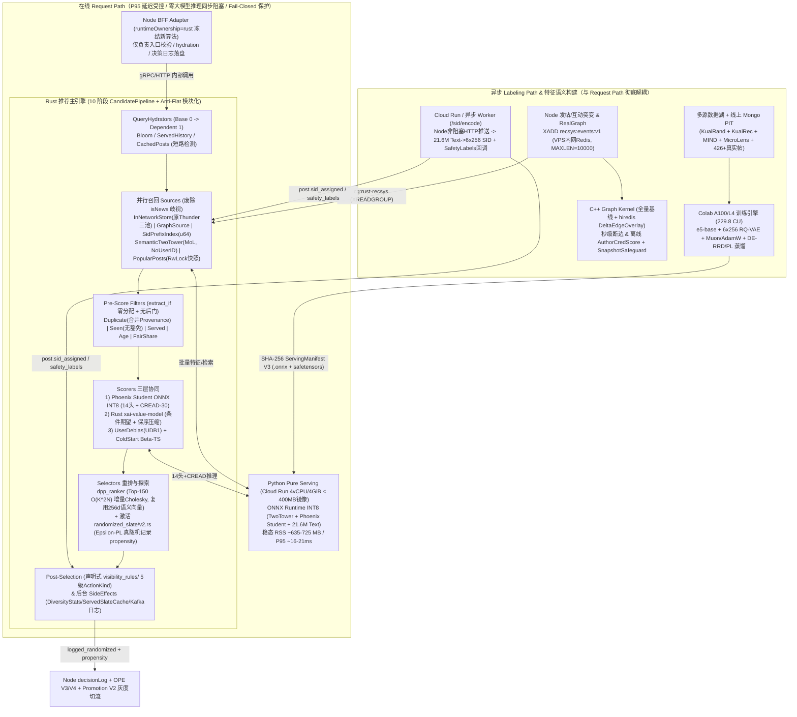

# Phase 28：推荐系统 V3 代际架构跃迁与全栈代码升级方案（对标 `xai-org/x-algorithm` 2026-11）

- **编制日期**：2026-11-15
- **阶段定位**：紧接 `Phase 27`（跨语言 Wire 契约漂移阻断门禁）后的**推荐系统核心算法与全栈工程代际重构阶段**
- **对标基线**：`xai-org/x-algorithm`（`main` 分支 `2026-11`、`commit 590f3926`，对应本地 `/Users/achilles/Documents/优秀开源项目/x-algorithm` `30647a8`）
- **规划状态**：**已批准立项（`Algorithm Research Gate`: `GO` — 用户已确认 5 项基建与部署定案，按 Phase 28A–28G 增量交付）**
- **生产部署与跨云约束定案（2026-11-15 实证拍板）**：
  1. **Drive 与数据集接入**：跳过本地 `drive.readonly` 授权，训练阶段直接通过 `colab drivemount` 挂载 `/content/drive`（剩 `4.8+ TB` 可用空间）并在必要时由 Colab CPU 会话中转至 GCS；`KuaiRand-27K` 必需表齐备，`MicroLens` 优先直连拉取英文文本或复用 Drive MMRec 预抽特征兜底；
  2. **线上 PIT 导出**：通过本机只读连接 `MONGODB_URI` 导出脱敏 `user_actions` (9,883 条) + `posts` (426 篇全含正文) 快照上传 GCS/Drive，不向 Colab VM 开放 Atlas `0.0.0.0/0`；
  3. **VPS 内存与跨云异步 SID 总线**：VPS (`886 MiB` RAM) 内网 `vps-redis-1` 保留 `REDIS_MAXMEMORY=192mb`，`recsys:events:v1` 严格控容 **`MAXLEN 10000`** 仅服务同机 Node $\rightarrow$ Rust/C++；跨云 `ml-worker` 改由 **Node 异步非阻塞 HTTP 直推 Cloud Run `/sid/encode` 并回调回写 + 写 `post.sid_assigned` 入内网 Redis**（不走跨区 Upstash 避免 `110.5 ms` RTT）；
  4. **Cloud Run 切流策略**：Phase 28D 对 `telegram-ml-services` 采用同服务 **Revision 灰度切流（`0% -> 5% -> 100%`）**，并同步将 `BACKEND_URL` 修正为 `https://api.xuziqi.tech`。

---

## 1. 执行摘要与总体决策

### 1.1 为何必须“代际跃迁 + 全栈代码重构”而非修补 V1？

综合 4 路只读架构调研及本仓跨语言源码、V1 训练产物（`2026-11-14_prod_v1`，消耗约 `17 CU`）与线上 MongoDB 抽样核查，当前系统同时存在**模型代差**与**工程链路结构性失血**：

1. **模型与语义表征代差（V1 过拟合坍塌 & 线上零命中）**：
   - V1 `PhoenixV2Ranker`（`94,439,870` 参数，约 `377.8 MiB`）把 **89.50M（94.76%）** 参数堆积在 5 张彼此孤立的 CRC32 ID Hash 表中，6 层 Transformer 骨干仅占 **4.74M（5.02%）**。训练期在 Epoch 1 后死记硬背 ID 噪声，`unbiasedMacroRocAuc` 从 Epoch 1 的 **`0.732743`** 一路崩塌至 Epoch 4 的 **`0.628777`**；而 `phoenix_v2_trainer.py`（L781-815）按 `valLoss <= best_val_loss` 误把最差的 Epoch 4 导出为生产模型。
   - 预处理开启 `metadata_mode="none"` 且线上 `telegram_clone` `426` 篇真实 `posts` 中 `isNews=true` 为 **`0`**（英文 414 篇，中文 22 篇）；`TwoTowerModel` 依赖静态 `.pkl` 闭集词表导致新帖全撞 `<UNK>`；Node `TwoTowerSource`、`PhoenixScorer` 与 `embeddingContractEvidence.ts` 硬拦截非新闻帖并缺少 `'semantic_ready'` 返回分支。
   - `weighted_calibrator.json` 13 个头中有 **7 个头**正例数为 `0` 退化为 `scale=1.0, bias=0.0`，`linear_model.json` 中 `quote` 与 `negative` 权重归零；训练缺少 `action_mask`（`phoenix_v2_trainer.py:118-142, 312-346`），推理适配器 `phoenix_adapter.py`（L255-284）则用硬编码线性拼接伪造 6 个缺失概率头；`ml-services` 全套产物 `817.64 MiB` 塞入混装爬虫与 `torch` 的单体 `app.py`（2361 行），迫使 Cloud Run `4 vCPU / 4 GiB` 长期降级停留在 `serving-lite`。
2. **Rust / Node / C++ 代码侧严重掉队与线上隐蔽 Bug**：
   - **主链路被 Node HTTP 锁死与阶段数脑裂**：`telegram-pipeline-primitives/src/stage_order.rs` 将 `CANONICAL_PIPELINE_STAGE_ORDER` 定义为 **9** 阶段（缺失 `DependentQueryHydrator`），与 `telegram-component-primitives`（早已定义 `QUERY_HYDRATOR_DEPENDENT_STAGE = 1`）自相矛盾；且 `PROVIDER_OWNED_PIPELINE_STAGES` 将 4 大核心阶段和模型打分锁在 `"rust_orchestrated_node_provider"` 走 JSON/HTTP 往返 Node。
   - **在线实装漏洞（已实证）**：
     - `seen_post_filter`（`pipeline/local/filters/mod.rs:478-509`）及 `seen_backup_filter.rs:48-66` 存在 `TRUSTED_EMPTY_SELECTION_RECALL_SOURCES` **免过滤后门**，放任已看帖子回流；而仓库已写好的 `ImpressionBloomFilter`、`ServedHistoryStore` 与 `CompositeRecommendationPipeline` 处于未接线空转。
     - `rule_signals.rs:182-204`（`visibility_gradient_signal`）匹配的 `vf.level` 枚举是 `"high_quality" | "standard" | "low_quality" | "borderline"`，而 Node `VFClient.ts:34` 与 Python `safety_module.py:15-21` 返回的是 `'safe' | 'low_risk' | 'medium' | 'high' | 'blocked'`，**导致可见性风险梯度系数 100% 落入 `_ => 1.0` 静默失效**。
     - `telegram-thunder-store` 是完全孤立的 **`0 callers` 死代码**，且使用全堆分配 `String` 与 $O(N)$ 全表遍历；`telegram-cpp-graph-service` 无实时 Redis 增量消费者，无法响应取关/拉黑秒级断边；Node `postMutations` / `RealGraphService` 未发射推荐使用增量流；`VFCandidateHydrator.ts` 仍在 Request Path 做同步字符串匹配或阻塞等待 Python。
   - **精排重排退化 & OPE 彻底阻塞**：
     - `rankingContract.ts:10-44` 与 `scorers/runner.rs` 串接多达 **33 步**手工打分器与**五重叠加作者衰减**（含仅用标量分桶充当“向量多样性”的 `embedding_diversity.rs`）；`TwoTowerSource` 计算出的 `48d` L2 向量在检索后即被丢弃，无法传递至重排 DPP；`weighted.rs` 的负分归一化分母使用了 `POSITIVE_WEIGHT_SUM (30.55)` 而非总权重和 `57.55`；
     - `exploration.rs:308-347` 使用确定性哈希 `stable_unit_interval` 假装 Thompson 采样；而仓内完备的 `telegram-randomized-policy-primitives/src/epsilon_plackett_luce.rs` 与 `randomized_slate/v2.rs` 被标为 `servable: false` 闲置，`decisionLog/write.ts:72-126` 直接拒绝写入 `logged_randomized`，卡死整个 OPE V3/V4 与 `promotion/v2` 放量门控。

### 1.2 Algorithm Research Gate 裁决与“三层治理原则”

- **门控裁决**：**`CONDITIONAL GO（条件放行）`** —— 严禁在 V1 稀疏 Hash 与 33 步手工因子框架上打补丁；全栈严格对标 `xai-org/x-algorithm`（`2026-11`）核心架构，同时围绕 `MongoDB + Redis Streams + Cloud Run 4vCPU/4GiB` 约束执行**三层精准治理**：
  1. **【核心对标必改】**：Semantic ID（`6 × 256` 打包进 `u64`）与无 ID MoL 双塔 + `SidSource` / `PopularPostsSource` / `CachedPostsSource` 体系；`HSTU + PLE + CREAD-30 + PAL + Muon` 训练与 `Plackett-Luce / DE-RRD` ONNX INT8 蒸馏；`telegram-value-model`（条件期望乘积 + 连续分段负分压缩）+ `UserDebias` + `AuthorColdStart` Beta-TS + `FairShareRankingFilter` + 增量 Cholesky `DPP` 重排 + 激活 `randomized_slate/v2.rs` 页级 RL 探索；Request Path 与异步 Labeling Path（`visibility_rules/` + `ContentSafetyLabels` + 局部图谱 `AuthorCredScore`）彻底解耦；`ml-services` 反扁平拆分为纯 `ONNX Runtime INT8` 服务容器与独立离线/爬虫 Worker。
  2. **【骨架增强】**：统一 Rust 10 阶段 Pipeline（补 `DependentQueryHydrator` + `TwoPhaseHydrator/CachedFetch` + `FilterResult::partition`）、消灭 `pipeline/local/*` 双轨分裂与 `>350L` 膨胀文件、激活并重造 `telegram-innetwork-store`（原 `thunder-store`）+ C++ `DeltaEdgeOverlay` 订阅 Redis Streams `recsys:events:v1`、新契约全数纳入 Phase 27 `cross-language-contract-drift-gate.sh` 静态+黄金门禁。
  3. **【严防盲抄裁剪】**：拒绝照搬 X 内部强绑定组件与重型超大规模基建——不引入 `Strato` / `Manhattan` / `Gizmoduck` / `TES` / `xds://` / `xai_urt_thrift`；不建独立 `visibility-filtering` / `SidLookupService` 微服务（合入 Rust 进程 + `Moka` 本地缓存 + 随路下发）；不跑 HDFS/Scalding `user-cred-v2` / `agatha`、Storm `TweetJob`、SQRL `botmaker`/`scarecrow`、GPU `bdsm` 与 `phoenix-rankall` 50 窗口 Parquet 集群，全部用 `Redis Streams + MongoDB + C++ 图核增量计算 + Cloud Run Batch Worker` 无缝平替；不盲开 X 的 64 离散头，坚守真实有监督的 **14 动作 + `action_mask` + `CREAD-30`**。

### 1.3 V3 全栈代际架构全景图



---

## 2. 对标 `xai-org/x-algorithm (2026-11)` 源码审计与前沿文献证据矩阵

### 2.1 X `2026-11` (`commit 590f3926`) 五大子系统源码实证清单

> **证据等级与诚实声明**：下表严格区分 `full_text`（已抓取源码全文并验证关键定义）、`partial`（因提取长度截断，完整核实前 45–54KB 或指定核心文件）、`abstract_or_public_description`（仅读 README/配置文件或目录列表）与 `unverified`（通过装配代码观察到名称引用，未单独抓读对应独立文件）。

| X 生产子系统 | 抓读精确文件与验证状态 | 核心架构设计事实与关键数值 | 本仓对应处置结论 |
| :--- | :--- | :--- | :--- |
| **1. `candidate-pipeline/` & `home-mixer/` 编排/召回/过滤/副作用** | **【`full_text`】**：`candidate-pipeline/{candidate_pipeline, hydrator, filter, source, side_effect}.rs`；`home-mixer/{for_you_candidate_pipeline, phoenix_scores_pipeline}.rs`、`sources/{sid_source, popular_posts_source, phoenix_source, phoenix_moe_source, cached_posts_source, simclusters_source, popular_posts_job}.rs`、`candidate_hydrators/semantic_id_hydrator.rs`、`filters/{previously_seen_posts_filter, previously_seen_posts_backup_filter, previously_served_posts_filter, age_filter, drop_duplicates_filter, fair_share_ranking_filter, dedup_conversation_filter, inventory_holdout_filter, fav_holdout_filter, zero_fav_codivert_filter}.rs`、`side_effects/{phoenix_request_cache_side_effect, response_diversity_stats_side_effect, reranking_kafka_side_effect, update_served_history_side_effect, redis_post_candidate_cache_side_effect, phoenix_experiments_side_effect, publish_seen_ids_to_kafka_side_effect}.rs`。<br>**【`partial`】**：`phoenix_candidate_pipeline.rs` (`0..52897B`, 已读全部装配)。<br>**【`unverified` 独立文件】**：`ThunderSource` / `TweetMixerSource` / `PhoenixTopicsSource`（仅在 `phoenix_candidate_pipeline.rs` 观察到装配引用）。 | • 严格 **10 阶段**（含 `DependentQueryHydrator`）与 `TwoPhaseHydrator`（全并发 `fetch_output` 再顺序就地 `apply_output`）+ `CachedFetch`（仅回源 miss 切片）+ `FilterResult::partition`（`extract_if` 零分配）；<br>• **`SidSource`**：`MaxResults=800, MaxSeeds=50, MaxPerSeed=100, MinPrefixDepth=3`，内联 `CoreDataHydrator` 且 `author_id != 0` fail-closed，与 `PhoenixMOESource` 互斥切换；<br>• **`PopularPostsSource`**：离线按 8h 半衰期筛选（`per_author=5, budget=500`）写紧凑二进制，线上 `RwLock<Snapshot>` + 每 `60s` `tokio::spawn` 异步刷新，空快照 fail-open；<br>• **`CachedPostsSource`**：Redis 读取 `zstd` 缓存 `>= 500` 条直接短路其余 8 路源与重型水合；<br>• **`PreviouslySeenPostsFilter`**：零豁免，彻底没有可信源绕过逻辑；`DropDuplicatesFilter` 合并副本 `retrieval_sources`。 | **Adopt / Adapt**：升级本仓为 10 阶段；补齐 `TwoPhaseHydrator/CachedFetch/partition`；新建 `sid_source`、`popular_source`、`cached_posts_source`；**立即删去本仓 `SeenFilter` 可信源绕过后门**。 |
| **2. `home-mixer/{scorers,selectors,ads}` + `xai-value-model/` + `vm-ranker/`** | **【`full_text`】**：`xai-value-model/{weights, scoring}.rs`；`vm-ranker/{user_debias_store, dpp, embedding_store}.rs`、`vm-ranker/scoring/{mod, debias, dpp_model}.rs`、`vm-ranker/params.rs`；`home-mixer/scorers/{author_cold_start, page_decode_rerank_scorer, page_rl_exploration_scorer, vm_ranker_debias_payload}.rs`、`home-mixer/selectors/{blender_selector, top_k_score_selector}.rs`、`home-mixer/ads/least_movement_blender.rs`、`home-mixer/params/param.rs`；`phoenix/xrex/models/{page_decoder, page_rl}.py`。 | • **`xai-value-model`**：30 项加权含 **3 项条件期望乘积**（`video_open * home/user_video_continuation_secs`, `profile_click * home_profile_visit_secs`）；分段连续负分压缩 `NEGATIVE_SCORES_OFFSET = 0.001`，分母为 `pos_sum + neg_sum`；互关回复加成 `15.0`；<br>• **`UserDebias`**：无锁加载 `UDB1`（超 `3600s` 自动跳过），对延迟重用请求用 `rows.retain_until(req_ms)` 严守 PIT，Logit 空间重中心化（`clip=2.0`）；<br>• **`AuthorColdStart`**：门槛限在非零分排名前比内且非转发非回复，用 $\text{Beta}(0.75 + x, 49.25 + n - x)$ 抽样取前 `ts_top_k=5` 再挑**基础分最高者**锚定提权至 `[slot_min, slot_max)`；<br>• **`DPP`**：仅对 Top-150 跑递增 Cholesky（`DppTheta=0.65`）或 10 分钟滑窗衰减，选后做**保分集合重映射**保持得分尺度；<br>• **`PageRlExplorationScorer`**：无 `page_decode_slot` 时于 Top-K 做无放回 Plackett-Luce 采样记录 `page_rl_exploration_prob`。 | **Adapt**：抽离独立无状态 Rust crate `telegram-value-model`，修复分母与删除 33 步平铺互乘；**复用检索端 256d L2 语义向量（不单独部署万维 `EmbeddingStore`）**落地 `selectors/dpp_ranker/`；激活仓内 `randomized_slate/v2.rs` 写入真 `propensity` 解锁 OPE V3/V4。 |
| **3. `thunder/` + `simclusters/` + `phoenix-rankall*` + `phoenix/`** | **【`full_text`】**：`thunder/{thunder_service.rs, posts/post_store.rs, kafka/tweet_events_listener.rs}`、`simclusters/{UpdateKnownForSBFRunner, SimClustersEmbedding, TweetJob}.scala`、`phoenix-rankall-strato/*.strato`、`phoenix-rankall/src/{main, config/mod, pipeline/mod, processor/metadata_processor, processor/sid_tail_processor, sid/backfill}.rs`、`phoenix/reference/{README.md, sid_codebook.py, dump_gen.py, world_snapshots.py, sid_index_server.py}`、`phoenix/crates/serving/{xai-recsys-sid-retrieval/src/{index, service}.rs, xai-recsys-engine/src/sid_client.rs, *.proto}`、`phoenix/xrex/{inference/launch_inference.py, models/{recsys_feature_prep, recsys_sid, recsys_two_tower_model, loss_recsys, recsys_attention, muon}}.py`。<br>**【`partial`】**：`thunder/kafka/tweet_events.rs`（`46/55.7KB`）、`phoenix-rankall/src/store/base.rs`（`46/53.8KB` + 尾部）、`recsys.proto`、`simclusters/{InterestedInFromKnownFor*, PersistentTweetJob, ApproximateCosineSimilarity, SimClustersANNCandidateSource}.scala`。 | • **`thunder`**：全定长 `Copy` `CompactPost` + 16B `TinyPost` 三池分离（原创/次级回复转发/时长 `>=5s` 视频池），严格对话树门控 + 分片周期 `shrink_to` 回收内存；<br>• **`simclusters`**：周/日离线 MH 社区发现 `KnownFor`，实时点赞 8h 半衰期衰减分写入帖-簇双向索引；<br>• **`phoenix/reference` 6×256 SID 铁律**：**Wire `int32` `[0, 256)` 与 `-1` 缺失 vs Model Buffer `uint16` `[1, 256]` 1-indexed 与 `0` 留作 PAD/OOV**；在线支持 `sid_prefix2` / `sid_prefix3` 与冻结解码 MLP 重建连续向量；<br>• **`xai-recsys-sid-retrieval`**：将 6 层 SID 打包进单个 `u64`（低 48 bit）维护有序表 `by_key` + `ArcSwapOption` 热换，用两次 `partition_point` 做到毫秒级全内存语义前缀检索（无向量引擎开销）；<br>• **`phoenix/xrex`**：双塔 `use_user_embedding=False` + `MoL (K=4)` + `ld` 完播；精排最后 2 层 `CandidateOnlyAttention` + `CREAD-30` 分位时长 + `Muon`+`AdamW` 混合优化。 | **Adapt & Cut**：重构本仓僵尸 `telegram-thunder-store` 为定长 `CompactPost` 三池存储并接入 `recsys:events:v1` Stream；将 `6×256` SID 统一打包为 `u64` 在 Rust 内建前缀索引；**切掉** `phoenix-rankall` 50+ Kafka Parquet 集群、Storm 与 Strato，改用 `Redis Streams + Rust/C++ Delta 内存索引`。 |
| **4. `visibility-filtering/` + Labeling Path (`user-cred-v2`/`scarecrow`/`agatha`/`grox`/`botmaker`/`bdsm`/`clip`)** | **【`full_text`】**：`visibility-filtering/` 核心引擎与规则集 `rules/{levels, safety_level, action_kind, rule_spec, tweet_rules, author_rules, catalog}.rs`（注：`README` 所链 `rules/registry.rs` 已实证拆分为 `levels.rs`+`engine.rs` 等）；`visibility-filtering-client/`；`user-cred-v2/` 核心 8 文件；`scarecrow/` 入口与 `.bot` 3 文件；`agatha/` 5 文件；`grox/` 5 文件；`safety-label-user-agg/*.strato`；`clip/` 2 文件。<br>**【`abstract_or_public_description`】**：`bdsm/`、`botmaker/`。<br>**【`unverified`】**：`botmaker/BUILD.bazel`、`bdsm/` 具体 Rust/JAX 实现、`rule_spec/` 细碎子文件。 | • **双链路铁律**：Request Path 只跑纯 Rust 声明式 `visibility-filtering`（`SafetyLevel` 9 级场景、`ActionKind` 7 档严格优先级、编译期按需裁剪水合 DAG 及 `Truth::{True, False, Unknown}` Fail-Open），**零在线文本正则和大模型推理**；<br>• **`AuthorSocialgraphFilter`**：同时校验双向拉黑、静音、转发原作者与引用原作者共 6 种边；<br>• **`user-cred-v2`**：每日 PageRank + `SnapshotSafeguard` 三道波动校验（行/总质量/大V变化 `<=5%`），全平台用作降权信号兼**高信誉免误杀白名单**；<br>• **`grox` / `agatha` / `safety-label-user-agg`**：发帖异步评估文本/图片安全写入结构化注解，单帖多次违规滚动聚合成 7 天作者标签。 | **Keep & Reject**：在 Rust 主进程内落地 `visibility_rules/` 注册表 + 修 `vf.level` 枚举错位 + 补全 6 种图谱屏蔽边；Labeling 走发帖异步写回 `PostFeatureSnapshot.contentSafetyLabels` + 举报聚合 + C++/Node 局部 `AuthorCredScore`；**坚决裁掉**独立 VF gRPC 集群、`scarecrow`/`botmaker` SQRL、`bdsm` GPU 流和 HDFS/Scalding `user-cred-v2`/`agatha`。 |

### 2.2 学术文献与工业研究证据矩阵（RQ1–RQ5）

| 研究问题 | 核心论文 / 报告与第一作者 | 年份/会议/机构 | 官方链接 | 阅读状态 | 核心机制、数据前提与本仓决策（Adopt / Adapt / Reject） |
| :---: | :--- | :---: | :--- | :---: | :--- |
| **RQ1** | **HSTU**: *Actions Speak Louder than Words: Trillion-Parameter Sequential Transducers for Generative Recommendations* (Jiaqi Zhai et al.) | 2024 / ICML / Meta | `https://arxiv.org/abs/2402.17152` | `full_text` | 非归一化 SiLU 注意力 + 相对时间与位置偏置 $rab^{p,t}$；需严格 PIT 时间戳。**Adapt**：吸收时间/位置相对注意力偏置 $rab^{p,t}$ 与最后 2 层 `CandidateOnlyAttention` 融入 Phoenix V3 GQA 骨干。 |
| **RQ2** | **TIGER**: *Recommender Systems with Generative Retrieval* (Shashank Rajput et al.) | 2023 / NeurIPS / Google DeepMind | `https://arxiv.org/abs/2305.05065` | `full_text` | 语义向量经残差量化生成离散码本；纯生成式 Beam Search 零样本冷启易跌近 0。**Adapt**：仅采纳 RQ-VAE（扩至 `6×256` + EMA 0.99 + 死码复活），拒绝自回归检索，改为双塔 + `u64` SID 前缀倒排。 |
| **RQ2** | **LIGER**: *Unifying Generative and Dense Retrieval for Sequential Recommendation* (Liu Yang et al.) | 2024 / arXiv | `https://arxiv.org/abs/2411.18814` | `full_text` | 验证纯 SID 生成冷启归零问题，证明 SID + 稠密语义混合召回可恢复零样本能力。**Adopt**：双塔候选塔同时融合 `6×256` SID（`sid_cross_attn` + 解码重建）与 `256d` 语义向量。 |
| **RQ2** | **SID Ranking**: *Better Generalization with Semantic IDs: A Case Study in Ranking for Recommendations* (Anima Singh et al.) | 2024 / RecSys / Google & DeepMind | `https://arxiv.org/html/2306.08121v2` | `full_text` | 证明完全丢弃 ID 仅用冻结多模态向量会丧失单品记忆使 AUC 下降；提出 N-gram Prefix 查表。**Adopt**：精排结合 `6×256` SID（Prefix2/3 查表+解码重建）+ 极轻残差 Light Hash（`num_hashes=2`）。 |
| **RQ3** | **MMoE** (Jiaqi Ma, 2018 KDD) -> **PLE**: *Progressive Layered Extraction* (Hongyan Tang et al.) | 2020 / RecSys / Tencent | `https://dl.acm.org/doi/10.1145/3383313.3412236` | `abstract_or_public_description` | 显式分离共享专家与任务组专属专家，消除正负反馈联合训练时的“跷跷板”负迁移。**Adopt**：替代单层头及 MMoE，拆为 2 共享专家 + 3 任务组专属专家（浅层互动 / 深度消费 / 负向防卫）。 |
| **RQ3** | **PAL**: *a position-bias aware learning framework for CTR prediction* (Huifeng Guo et al.) | 2019 / RecSys / Huawei | `https://dl.acm.org/doi/10.1145/3298689.3347033` | `abstract_or_public_description` | 训练期独立分支吸收展示位偏差 `served_position`，推理置零。**Adopt**：对标 `x-algorithm` `_POSITION_EDGES` 分桶消除榜首位置偏置。 |
| **RQ3** | **D2Q**: *Deconfounding Duration Bias in Watch-time Prediction* (Ruohan Zhan et al.) | 2022 / KDD / Kuaishou | `https://ar5iv.labs.arxiv.org/html/2206.06003` | `full_text` | 视频物理时长混淆后门分位纠偏（XGAUC 0.6693）；纯图文帖无视频物理封顶时长 $D$。**Adapt**：借鉴时长条件特征，主回归头采用更通用的 `x-algorithm` **`CREAD-30`** 序数停留分布。 |
| **RQ4** | **Log-Q (NDR)** (Yi et al., 2019) & **DE-RRD** (`10.1145/3340531.3412005`) / **SDR** (`2109.15285`) / **PLD** (`2506.12542`) *(RankDistil 未查原文标记 `unverified`)* | 2019–2025 / RecSys / CIKM / arXiv | `https://doi.org/10.1145/3340531.3412005`<br>`https://arxiv.org/pdf/2506.12542` | `abstract_or_public_description` | `Log-Q` 修正 In-Batch 采样频次偏差；`PLD` 构建选择理论 Plackett-Luce 凸排序蒸馏，`DE-RRD`/`SDR` 实证推荐列表蒸馏；`RD-Suite (2306.04455)` 提示防异构过拟合。**Adopt/Adapt**：双塔用 In-Batch+64 全局负采 Log-Q；蒸馏融合 Plackett-Luce Listwise + DE-RRD KL + CREAD。 |
| **RQ4** | **Muon Scaling**: *Muon is Scalable for LLM Training* (Liu, Su, Yang et al.) | 2025 / arXiv `2502.16982` / Moonshot | `https://arxiv.org/abs/2502.16982` | `abstract_or_public_description` | 2D 权重正交化优化（5 步 Newton-Schulz + RMS 对齐）获 ~2x 训练效率，不适用于 Embedding/1D 参数；搭配 EMA 平滑谷底微震荡。**Adopt**：严格对齐 `x-algorithm/muon.py` 与 AdamW 分治 + EMA 0.999。 |
| **RQ5** | **Fast Greedy DPP**: *Fast Greedy MAP Inference for Determinantal Point Process* (Laming Chen et al.) | 2018 / NeurIPS / Hulu (`1709.05135`) | `https://arxiv.org/pdf/1709.05135` | `abstract_or_public_description` *(源码全实证 `dpp.rs`)* | 递增 Cholesky 将贪心 DPP MAP 重排压至 $O(K^2 N)$。**Adopt**：按 `vm-ranker/dpp.rs` 落地 Rust `selectors/dpp_ranker/`（< 0.5ms）。 |

---

## 3. 多源语义数据湖、`action_mask` 契约与【需用户确认补充的数据集清单】

### 3.1 为什么“仅有快手纯 ID”必败？——中英跨域语义底座

线上 MongoDB `telegram_clone` 真实 `posts` 约 97% 为英文科技/资讯社交帖（414 篇）、5% 为中文帖（22 篇），且 `isNews=true` 为 0。仅用全汉字视频数据集且 `--metadata-mode none` 必然造成在线全 `<UNK>`。必须通过**多源中英混合数据 + 统一 `intfloat/multilingual-e5-base` (`768d -> 256d`) + 确定性 `6×256` RQ-VAE 码本**把中英文内容对齐到同一语义 ID 坐标系。

### 3.2 Google Drive 现状只读检查指令

请在 Colab 挂载 Drive 后执行以下指令，确认物理目录已有文件（此前 V1 `preprocess_manifest.json` 仅表明交互日志就位，尚未核实视频元信息与画像表是否齐备）：

```bash
ls -lh /content/drive/MyDrive/ml-services/data/
ls -lh /content/drive/MyDrive/ml-services/data/KuaiRand/KuaiRand-27K/data/
ls -lh /content/drive/MyDrive/ml-services/data/KuaiRec/KuaiRec\ 2.0/data/ 2>/dev/null || ls -lh /content/drive/MyDrive/ml-services/data/KuaiRec/ 2>/dev/null
```

### 3.3 【分流清单】Colab 自动高速拉取 (A 类) vs 需您协助核查/补充 (B 类)

#### A 类：Colab 云端脚本免登录全自动拉取（无需您本地操作）

| 数据集 / 预训练编码器 | 精确文件清单与体积 | 已核实直链地址 | Drive 目标路径 | 核心补充价值 |
| :--- | :--- | :--- | :--- | :--- |
| **1. MIND-Large (Train + Dev)** | • `MINDlarge_train.zip` (**531 MB**, ~5.1万新闻 / 223万曝光)<br>• `MINDlarge_dev.zip` (**104 MB**)<br>• 可选 `MINDlarge_utils.zip` (**150 MB**) | *注：微软旧 Azure 链接已 409 失效，使用 HF 官方镜像：*<br>`https://huggingface.co/datasets/Recommenders/MIND/resolve/main/MINDlarge_train.zip`<br>`https://huggingface.co/datasets/Recommenders/MIND/resolve/main/MINDlarge_dev.zip` | `MyDrive/ml-services/data/MIND/` | **核心刚需**：16 万条**英文**标题/摘要/实体 + 真曝光点击/未点击日志，打通线上 95% 英文社交帖冷启。 |
| **2. KuaiRec 2.0 明文特征包** | • `KuaiRec.zip` (**432.0 MB**)<br>• `kuairec_caption_category.csv` (**2.0 MB**, 中文 `caption` + 3 级类名)<br>• `video_raw_categories_multi.csv` (**1.7 MB**)<br>• `user_features_raw.csv` (**1.5 MB**, 明文画像) | `https://zenodo.org/records/18164998/files/<文件名>`（Zenodo 免登录直连） | `MyDrive/ml-services/data/KuaiRec/` | 补齐中文标题、多级类目与明文用户画像，避免 `--metadata-mode none` 灾难。 |
| **3. KuaiRand-27K 2026 标题/4级类目** | • `kuairand_video_captions.csv` (**3.2 GB**, `final_video_id, caption, show_cover_text, duration`)<br>• `kuairand_video_categories.csv` (**3.7 GB**, 1~4 级类名) | `https://zenodo.org/records/18159199/files/<文件名>`（*下载后在 Colab 流式按 `final_video_id == video_id` 过滤转压缩 Parquet，省 60% 存储*） | `MyDrive/ml-services/data/KuaiRand/KuaiRand-27K/content/` | 填补 27K 视频内容语义空白。 |
| **4. MicroLens-100k 文本交互子集** | • `MicroLens-100k_pairs.csv` (**17.4 MB**), `.tsv`<br>• `MicroLens-100k_title_en.csv` (**1.41 MB**)<br>• `tags_to_summary.csv` (**330 KB**)<br>• `MicroLens-100k_comment_en.txt` (**35.7 MB**) | 优先直连 `https://recsys.westlake.edu.cn/MicroLens-100k-Dataset/<文件名>`（共 ~55MB；若节点对 Colab IP 限流则走下表 B 类快捷方式） | `MyDrive/ml-services/data/MicroLens/MicroLens-100k/` | 英文标题 + 标签 + 71.9 万条用户评论（*无曝光负样本，需屏蔽 `exposure_mask`*）。 |
| **5. 多语言语义编码器** | • `intfloat/multilingual-e5-base` (**1.11 GB**, 768d)<br>• 可选 `intfloat/multilingual-e5-small` (384d) | HuggingFace Hub 自动拉取（严格使用 `"query: "` / `"passage: "` 前缀） | `MyDrive/ml-services/models/encoders/` | 离线生产统一双语 768d 向量 $\rightarrow$ 投影 256d 训练 `6×256` RQ-VAE 码本及蒸馏 21.6M 在线小模型。 |

#### B 类：【需您协助检查/补充】的数据与操作清单

| 优先级 | 数据名称与精确文件名 | Drive 目标位置 | 需要您协助的原因与精确操作 |
| :---: | :--- | :--- | :--- |
| **P0 (已核实)** | **KuaiRand-27K 基础与用户表**<br>`video_features_basic_27k.csv` (`2.6 GB`), `user_features_27k.csv` (`3.4 MB`) *(注：`video_features_statistic_27k_part1..3.csv` [20.1GB] 为全周期静态统计，严禁直入历史特征以防未来泄露，由脚本白名单自动排除)* | `MyDrive/ml-services/data/KuaiRand/KuaiRand-27K/data/` | **已通过 Drive 核查齐备**（Drive 余量 `4.8+ TB`，训练时直接通过 `colab drivemount` 挂载读取并承接断点）。 |
| **P0 (本机导出)** | **线上 `telegram_clone` 真实全量 PIT + 正文导出** | `gs://telegram-467705-recsys/datasets/prod_pit_v3/` & Drive | 线上集合为 `user_actions`（9,883 条）与 `posts`（426 篇且均含正文）。Phase 28A 修复 [pit_export.py](file:///Users/achilles/Documents/telegram_code/telegram/ml-services/recsys/data/pit_export.py) 后**直接在本地执行只读脱敏导出推入 GCS/Drive**，不向 Colab IP 开放 MongoDB Atlas 白名单。 |
| **P1 (已挂载兜底)** | **MicroLens-100k MMRec 特征兜底包**（`microlens.inter`, `text_feat.npy`, `image_feat.npy`, `video_feat.npy`） | `MyDrive/ml-services/data/MicroLens/` | 已挂载至 `1UC9064QA0CL42D14V_qPzEoe-ELm35Va`（为预抽特征格式，不含明文标题）。Colab 仍优先直连 Westlake 拉取 `~55MB` 英文标题/评论子集，超时时自动回退复用该 `.inter`/`.npy` 包。 |
| **已淘汰** | `Tenrec` / `AliExpress` / `KuaiSAR` | — | **请勿下载**：`Tenrec` 已删时间戳破坏 PIT；`KuaiSAR` 全文哈希脱敏；`AliExpress` 为匿名电商数值。 |

### 3.4 V3 统一 14 动作契约与 `action_mask` 防污染样本表

严防盲抄 X 的 64 个稀疏头，严格对齐本仓 `ml-services/recsys/contracts/actions.py` 与 `WeightedScorer` 定义 **13 个二分类头 + `CREAD-30` 连续 `dwell_time` 头**，同时每条样本必须携带 **`action_mask: uint8[13]`** 与 **`dwell_mask: uint8`**：只有原数据集真实采集了对应动作时置 `mask=1`，否则置 `0` 并在 BCE Loss 中严格屏蔽梯度，彻底解决 V1 7 个动作正例为 `0` 导致的退化问题！

| 槽位 | V3 标准动作名 | 极性 / 先验权重 | 线上 `telegram_clone` 映射 | KuaiRand-27K 映射 | KuaiRec 2.0 映射 | MIND-Large 映射 | MicroLens-100k 映射 |
| :---: | :--- | :---: | :--- | :--- | :--- | :--- | :--- |
| 0 | `click` | 正 / `0.5` | `click, open_link` (`1`) | `is_click > 0` (`1`) | `watch_ratio >= 0.55` (`1`) | `impressions -1/-0` (`1`) | 评论隐式正样本 (`1`, 配全局负采) |
| 1 | `like` | 正 / `2.0` | `like, favorite` (`1`) | `is_like > 0` (`1`) | `watch_ratio >= 2.0` (`1`) | `0` (**`mask=0`**) | `0` (**`mask=0`**) |
| 2 | `reply` | 正 / `5.0` | `reply` (`1`) | `is_comment > 0` (`1`) | `0` (**`mask=0`**) | `0` (**`mask=0`**) | 存在评论 (`1`) |
| 3 | `repost` | 正 / `4.0` | `repost, retweet` (`1`) | `is_forward > 0` (`1`) | `0` (**`mask=0`**) | `0` (**`mask=0`**) | `0` (**`mask=0`**) |
| 4 | `quote` | 正 / `4.5` | `quote` (`1`) | `0` (**`mask=0`! 禁假负**) | `0` (**`mask=0`**) | `0` (**`mask=0`**) | `0` (**`mask=0`**) |
| 5 | `share` | 正 / `2.5` | `share, dm, copy_link` (`1`) | `is_forward > 0` (`1`) | `0` (**`mask=0`**) | `0` (**`mask=0`**) | `0` (**`mask=0`**) |
| 6 | `dwell` | 正 / `0.3` | `dwellTimeMs >= 5000` (`1`) | `long_view` 或 `>=5s` (`1`) | `play >= 5s` / `ratio>=0.5` (`1`) | `0` (**`mask=0`**) | `0` (**`mask=0`**) |
| 7 | `video_view` | 正 / 辅助 | 播放 `>=3000ms` (`1`) | `play >= 3000ms` (`1`) | `has_video & play>=3s` (`1`) | `0` (**`mask=0`**) | `0` (**`mask=0`**) |
| 8 | **`video_quality_view`** *(V3 独立头)* | 正 / **`3.0`** | 完播或看超 50% (`1`) | `long_view > 0` 或完播率 `>=0.8` (`1`) | `watch_ratio >= 1.0` (`1`) | `0` (**`mask=0`**) | `0` (**`mask=0`**) |
| 9 | `follow_author` | 正 / `2.4` | `follow_author` (`1`) | `is_follow > 0` (`1`) | `0` (**`mask=0`**) | `0` (**`mask=0`**) | `0` (**`mask=0`**) |
| 10 | `not_interested` | 负 / `-5.0` | `dismiss, hide, not_interested` (`1`) | `is_hate > 0` (`1`) | `watch_ratio < 0.12` (弱权 `0.5`) | 曝光未点击 (`mask=0`) | `0` (**`mask=0`**) |
| 11 | `block_author` | 负 / `-10.0` | `block_author` (`1`) | `0` (**`mask=0`**) | `0` (**`mask=0`**) | `0` (**`mask=0`**) | `0` (**`mask=0`**) |
| 12 | `mute_author` | 负 / `-4.0` | `mute_author` (`1`) | `0` (**`mask=0`**) | `0` (**`mask=0`**) | `0` (**`mask=0`**) | `0` (**`mask=0`**) |
| 13 | `report` | 负 / `-8.0` | `report` (`1`) | `0` (**`mask=0`**) | `0` (**`mask=0`**) | `0` (**`mask=0`**) | `0` (**`mask=0`**) |

> **全局编码与 PIT 统一铁律**：
> 1. **Semantic ID 跨语言编码规范**（直接对齐 `x-algorithm` `phoenix/reference/sid_codebook.py` & `recsys_feature_prep.py`）：全仓统一使用 **`6 × 256` 码本**：**Wire 传输与数据库/流协议格式为 `int32[6]`（值域 `0..255`，`-1` 表缺失）**；**模型张量格式为 `uint16[6]`（1-indexed `1..256`，`0` 保留给 PAD/OOV）**；**Rust `SidPrefixIndex` 将 `uint8[6]` 无损打包为单个 `u64`（低 48 bit）做毫秒级二分前缀召回**，彻底消除多套码本分裂。
> 2. **PIT 附带字段**：统一样本强制带 `action_ts_ms`、`served_position`（供 PAL 与决策日志使用）、`propensity_status` (`logged_randomized` / `not_evaluable_deterministic`)、`propensity_score`。

---

## 4. 全栈跨语言代码侧代际架构升级与 Anti-Flat 改造清册

> 所有代码改造均遵守 `AGENTS.md` 中的 **Anti-Flat Architecture Rule**（禁止向已拥挤目录堆平铺文件，所有 `>350L` 膨胀文件拆入领域子目录）与 Phase 27 跨语言门禁。

### 4.1 跨语言 Wire 契约与 Redis Streams 实时特征总线（全局枢纽）

#### A. 共享契约库：`telegram-rust-workspace/crates/telegram-recommendation-contracts/` & Phase 27 CI 门禁

按职责拆开超长契约文件（`candidate.rs` 591L -> `candidate/{mod, core, scores, slate, safety, provenance}.rs`；`query.rs` 496L -> `query/{mod, request, sequences, history}.rs`；`pipeline.rs` 444L -> `pipeline/{mod, stage, telemetry}.rs`），严守 Postel 向后兼容原则扩展 V3 契约字段，并同步纳入 `telegram-rust-workspace/scripts/cross-language-contract-drift-gate.sh` 校验：

| 契约载体 | 新增/升级 V3 字段（Wire 格式） | 对标来源与业务用途 |
| :--- | :--- | :--- |
| **`RecommendationCandidatePayload`** | • `semantic_ids: Option<[i32; 6]>`（`0..255`, `-1` 缺失）<br>• `semantic_embedding_256d: Option<Vec<f32>>` *(或 `Vec<f16>` / 轻量压缩传重排侧)*<br>• `retrieval_sources: Vec<RetrievalSourcePayload>`（`source_type, cluster, score, position`）<br>• `author_cred_score: Option<f64>`、`content_safety_labels: Option<ContentSafetyLabelsPayload>`<br>• `slate_context: Option<Box<SlateContextPayload>>` & `served_slate_context`（含 `k, pool_rank, sid_known, sid_k_l1..3, sid_gap_l1..3, recon_cos_milli, pre_diversity_score`）<br>• `page_decode_slot: Option<u32>`、`page_rl_exploration_prob: Option<f64>` | 打通 `SidSource`、语义 256d 向量透传给 `dpp_ranker`、异步标签/信誉消费、多种子去重溯源保留、Page RL 探索与 `SlateContext` 日志闭环。 |
| **`PhoenixScoresPayload`** | • 对齐 **13 真实二分类动作概率 + `expected_dwell_sec`（CREAD-30 期望还原秒数）+ 条件期望辅助字段**（`video_continuation_secs`, `profile_visit_secs`）<br>• 标记旧合成字段（`quoted_click`, `photo_expand`, `share_via_dm`, `share_via_copy_link`）为兼容只读可选弃用域，不再参加 V3 Value Model 线性伪加法。 | 彻底告别 `phoenix_adapter.py:255-284` 伪造 6 个概率头的假繁荣，使模型输出与 Rust 价值层端到端真对齐。 |
| **`RecommendationQueryPayload`** | • `columnar_retrieval_sequence` & `columnar_scoring_sequence`（含 `post_id_hash, semantic_ids, author_hash, action_type, action_mask, time_delta_sec`）<br>• `bloom_filter_entries`, `served_history`, `cached_posts`, `has_cached_posts`, `seed_candidate_post_ids`, `prediction_id` | 支撑 `UseUserEmbedding=False` 无 ID 序列双塔、PIT UserDebias 序列裁剪、`ImpressionBloomFilter` 下推召回与 `CachedPostsSource` 短路。 |

#### B. 统一内网 Redis Streams (`recsys:events:v1`) + 跨云非阻塞 HTTP 异步 SID/Safety 架构

鉴于生产 VPS 总物理内存为 `886 MiB` 且 `vps-redis-1` 限额 `192mb (allkeys-lru)`，保留 VPS 内网专用流 Key `recsys:events:v1` 严格配置 **`MAXLEN 10000`**（约 `2–5 MB` RAM，不切跨区 Upstash），并与 `user_events_stream` / `platform:events:v1` 物理隔离；跨云侧由 Node 异步非阻塞 HTTP 直推 Cloud Run `/sid/encode` 计算后写回并广播 `post.sid_assigned`：

| Topic / 通道 | 生产者 (Node) | 紧凑 Payload 核心字段 | 消费者与增量状态变更 |
| :--- | :--- | :--- | :--- |
| `post.created` (`Stream` + 异步 HTTP `/sid/encode`) | `postMutations.ts` / `NewsMaterializationService.ts` | `postId, authorId, createdAtMs, isReply, isRepost, replyToPostId, originalPostId, conversationId, hasVideo, videoDurationSec, sids?: [i32; 6]` | **Rust `InNetworkStore`**：写三池及前缀索引。<br>**Cloud Run `/sid/encode`（Node 异步非阻塞 HTTP 直推）**：对无 `sids` 新帖生成 `6×256` SID + `ContentSafetyLabels` 并回调回写。 |
| `post.deleted` | `postMutations.ts` | `postId, authorId, deletedAtMs` | **Rust**：写入 `deleted_posts` 墓碑并摘除三池及 `SidPrefixIndex` 条目。 |
| `post.sid_assigned` | `PostFeatureSnapshotService` / `ml-worker` | `postId, authorId, createdAtMs, codes: [i32; 6], safetyLabels, codebookVersion` | **Rust**：更新 `Moka` SID 缓存、写 `SidPrefixIndex` 与异步 `ContentSafetyLabels` 缓存。 |
| `post.engaged` | `interactions.ts` | `userId, postId, authorId, actionType, clusterIds, halfLife8hDelta, reportTriggered, occurredAtMs` | **Rust**：更新 `SimClusters` 8h 半衰期滑窗热度及负反馈疲劳计数。 |
| `graph.edge_delta` | `RealGraphService.ts` | `sourceUserId, targetUserId, deltaScore, edgeKinds, isUnfollowOrBlock, updatedAtMs` | **C++ 图核**：实时更新 `DeltaEdgeOverlay`，取关/拉黑立即秒级断边生效。 |

---

### 4.2 Rust 推荐主引擎 & 原语 Crates (`telegram-rust-workspace/`)

#### A. 修复 10 阶段编排、消除双轨目录与解除 Node HTTP 锁死

| Crate / 模块 | 现状问题诊断 | 改造清册（Anti-Flat 目标目录拆分） |
| :--- | :--- | :--- |
| **`telegram-pipeline-primitives`** | `CANONICAL_PIPELINE_STAGE_ORDER` 只有 9 阶段（缺 `DependentQueryHydrator`）；`PROVIDER_OWNED_PIPELINE_STAGES` 锁死 4 阶段走 Node HTTP。 | • 升级为严格 **10 阶段**（紧随 `QueryHydrator` 插入 `DependentQueryHydrator`，对齐 `telegram-component-primitives` stage=1 定义）；<br>• 按阶段灰度开关解除 Node Provider 锁定，把调度与组装收敛回 Rust；新增 `result_size_for` 与 `retain_retrieved_candidates` 契约。 |
| **`telegram-component-primitives` & `telegram-filter-primitives`** | 仅有 `CachedHydrator` 而缺 `TwoPhaseHydrator` / `CachedFetch` 并发拉取原语；Filter 退化为手写 `FilterFn` 全量分配。 | • `cached_hydrator.rs`（353L）拆分为 `hydrator/{mod, two_phase, cached_fetch, moka_store}.rs`：实现 `join_all` 全并发 `fetch_output` 再就地 `apply_output`，`CachedFetch` 跳过已有字段只补漏；<br>• `filter_trait.rs`（345L）拆为 `filter/{mod, partition, context}.rs`，落地对齐 X 的零分配 `FilterResult::partition`（`extract_if`）。 |
| **`telegram-rust-recommendation` 收编双轨目录** | 并存 `src/{filters, candidate_hydrators, query_hydrators, side_effects}/` 与 `src/pipeline/local/*`；`pipeline/local/filters/mod.rs` (717L)、`query_hydrators/batch.rs` (626L)、`sources/contracts.rs` (580L) 等单体文件严重膨胀；`CompositeRecommendationPipeline` 未接入 `server/app.rs`。 | • 废弃双轨：`pipeline/local/*` 全部逻辑收编到顶层领域目录 `{query_hydrators, sources, candidate_hydrators, filters, scorers, selectors, side_effects, serving, context, sync}/`；清理死代码 `src/filters/{blocked_by, subscription_filter, video_filter}.rs`；<br>• 将 `pipeline/builder.rs::build_composite()` 正式接入 `server/app.rs::build_app_state`；<br>• 所有 `>350L` 单文件（`filters/mod.rs`, `batch.rs`, `contracts.rs`, `execution.rs`, `boundary.rs`, `manifest.rs`, `request_caching.rs`, `diversity_stats.rs`, `exploration.rs`, `backend_client.rs`）拆分为职责单一子模块。 |

#### B. 召回、内存索引与 Stream 实时同步改造（激活僵尸 `thunder-store` + 新增 `sid_source`）

1. **重构并激活 `crates/telegram-thunder-store/`（建议语义演进为 `InNetworkStore`，彻底解决 `0 callers`）**：
   - **数据结构升级（对标 X `CompactPost` & `post_store.rs`）**：抛弃全堆 `String` 的 `LightPost` 与 $O(N)$ `get_by_topic` 扫描；采用紧凑 `CompactPost`（Intern/定长 ID 与时间戳）与三池 `DashMap<u64, VecDeque<TinyPost>>`——**原创池 (`original_by_author`)、回复/转发次级池 (`secondary_by_author`)、视频池 (`video_by_author`, 判定 `has_video && duration_sec >= 5 && !is_reply`)**；实现反向扫描、关注链对话树门控、`deleted_posts` 墓碑及周期分片 `shrink_to` 内存回收。
   - **接入 Redis Streams**：新增 `src/sync/stream_consumer.rs`（复用 workspace 既有 `redis = "0.27"`），启动 `XGROUP CREATE recsys:events:v1 cg:rust-recsys` + `XREADGROUP` + `XAUTOCLAIM` 实时消费发帖、删帖、SID 赋值与 8h 半衰期互动增量。
2. **新增 `sources/semantic_id_source/` + `state/sid_index.rs`（对标 X `SidSource` & `xai-recsys-sid-retrieval/src/index.rs`）**：
   - 在 Rust 进程内把 `6 × 256` SID 打包入单个 **`u64`（低 48 bit）** 维护有序数组 `by_key: ArcSwap<SidPrefixIndex>`；在线提取用户正反馈种子帖 SID，自顶向下按共享前缀深度 `6 -> 5 -> 4 -> 3` 执行两次 `partition_point` 二分定位最近帖区间、去重轮询 `interleave` 召回（毫秒级无向量引擎语义检索）；
   - 接入 `SemanticIdHydrator`（`CachedFetch` + `Moka` 本地缓存，淘汰跨服务单独部署 `SidLookupService`）确保所有非 SID 召回候选同样补齐 `semantic_ids` 与 `SlateContext` SID 统计；
   - 取消 `sources/orchestrator/execution.rs` 的 **`isNews` 硬限**，新增 `sources/two_tower/` 对接 V3 `UseUserEmbedding=False` + `MoL` 检索服务并携带 `semantic_embedding_256d`（同时下推 `seen_ids` + `served_ids` + `ImpressionBloomFilter` 到召回层过滤）。
3. **新增 `sources/popular_source/` & `sources/cached_posts_source/`（严格区分 `source_cache`）**：
   - `sources/popular_source/`：后台周期按 8h 半衰期从 Redis 异步刷新时间衰减热帖，线上 `RwLock<Snapshot>` 无锁只读，空快照 Fail-Open；
   - `sources/cached_posts_source/`：实现 Feed 级 `zstd` 缓存短路（达标即跳过重召回/水合），原 `sources/cached_posts.rs`（513L）更名为 `sources/source_cache/` 以正名。

#### C. 过滤器漏洞修复、声明式可见性引擎与公平配额

1. **`filters/seen.rs` & `seen_backup.rs`（P0 安全修补）**：**彻底删除** `TRUSTED_EMPTY_SELECTION_RECALL_SOURCES` 免过滤漏洞后门；正式接线仓库内休眠的 `ImpressionBloomFilter`（`serving/impression_bloom.rs`）与 `ServedHistoryStore`（`serving/served_history.rs`）；修复 `dedup.rs` / `retweet_dedup.rs`，在剔除副本时**强制将 `retrieval_sources` 合并到首条保留候选**。
2. **`filters/visibility_rules/`（【新增模块化子目录】，替代硬编码 `vf_filter`）**：
   - 对标 `x-algorithm/visibility-filtering/rules/{safety_level, action_kind, levels, engine}.rs`，实现单进程声明式 `SafetyLevel` 注册表、`ActionKind` 严密优先级（`Drop > Tombstone > Interstitial > Downrank > Allow`）及三值 `Truth::{True, False, Unknown}` 评估明细（`Rescue` 阶段强制同源过规则）；
   - **修复 `rule_signals.rs:182-204` 枚举错位 Bug**：让 `visibility_gradient_signal` 识别 Node/Python 真实的 `'safe' | 'low_risk' | 'medium' | 'high' | 'blocked'`，同时消费异步落库的 `contentSafetyLabels` 与 `authorCredScore`（对高信誉用户豁免轻度文本误伤）；
   - 在 `author_socialgraph_filter.rs` 补齐 `repost_author_id` 与 `quoted_author_id` 双向拉黑校验。
3. **新增 `filters/fair_share.rs` & `filters/causal_holdout.rs`**：使用 `u128` 最大余数法（Hamilton 方法）在进 Phoenix 精排前按召回来源等比配额裁剪（防某路大源挤爆 64 候选预算）；用确定性 SplitMix64 哈希为实验预留统计对照切片。

#### D. `telegram-value-model`、`UserDebias`、`ColdStartTS`、`DPP` 重排与真探索激活

1. **升级 `telegram-ranking-primitives` / 独立无状态 crate `crates/telegram-value-model/`（对标 `xai-value-model`）**：
   - 将原 808L 单体拆分并落地共享无状态 Value Model：使用**真实校准后 13 离散头概率 + 3 项条件期望乘积（如 $P(\text{video\_view}) \cdot E[\text{dwell}]_{\text{cond}}$、$P(\text{click}) \cdot E[\text{dwell}]_{\text{cond}}$、互关回复提权）**，**彻底删除 33 步手工因子串联及 5 重作者叠加惩罚**（只保留单层归一化 `author_diversity = (1.0 - floor) * decay^k + floor`）；
   - **修复 `weighted.rs` 负分归一化数学口径 Bug**：将分母从 `POSITIVE_WEIGHT_SUM (30.55)` 改为精确总和 `pos_sum + neg_sum`（对标 X `offset_score = (s + neg_sum) / total_sum * 0.001` 当 `s < 0`），并支持可逆 `unoffset_score` 以叠加探索奖励；
   - 新增离线校准驱动的轻量 **`UserDebias`**（单进程 `ArcSwapOption` 热载轻量化行为偏差表，PIT `rows.retain_until(req_ms)` 截断后在 Logit 空间重中心化，超 `max_artifact_age_secs` 自动 Skip 回退）。
2. **`scorers/primary_with_fallback.rs` & `scorers/cold_start_ts/`**：
   - Rust 直接经 HTTP/2 连接池并批调用 Python ONNX 精排（`phoenix_timeout_ms=350ms`、5xx/超时 `>10%` 自动熔断降级至基于本地特征的 Fallback 并记录 `primary_with_fallback` Trace）；
   - 替换 `exploration.rs:308-347` 的伪随机确定性哈希 jitter：落地对标 `author_cold_start.rs` 的真实 **Beta-Thompson Sampling (`Beta(0.75 + x, 49.25 + n - x)`)**——仅限低曝光非回复/非转发新帖，且在模型基础分排名前百分比内取 Beta 采样 Top-5 中的**基础分最高者**提权至 `[slot_min, slot_max)`。
3. **`selectors/dpp_ranker/`（对标 `x-algorithm/vm-ranker/dpp.rs`）**：
   - 新建子目录 `selectors/dpp_ranker/{mod, config, kernel, greedy, window, simd, metrics}.rs`；
   - **零独立大型向量库开销**：直接消费召回阶段随路透传的 Candidate **`semantic_embedding_256d`（转 `half::f16` 省 50% L1 带宽；或缺失时直接用 SID 解码重建近似余弦）**，对 Top-`150` 候选构造 $L_{ij} = q_i q_j \cos(e_i, e_j)$（$\theta = 0.65$），执行 $O(K^2 N)$（`< 0.5 ms`）增量 Cholesky 贪心 + 10 分钟跨页滑动窗口衰减惩罚，最后以**保分集合重映射 (`dpp_selected` zip 原降序分数)** 输出，无缝衔接 `TopKScoreSelector`。
4. **激活 `serving/policy/randomized_slate/v2.rs` & 完善 `side_effects/`**：
   - 将仓库里已写完但处于离线模拟状态的 `telegram-randomized-policy-primitives/src/epsilon_plackett_luce.rs` 与 `randomized_slate/v2.rs` 正式接入 `Selector` 末尾作为页级探索（默认开启 5% 探索槽位 $\varepsilon$-Plackett-Luce 无放回采样），把精确 **联合探索概率 `propensity` / `page_rl_exploration_prob`** 写入 `ServedSlateCacheSideEffect` 并返回 Node；
   - 修复 `side_effects/runtime.rs:86-126` 传空 Query 漏洞，将 `DiversityStatsSideEffect`（含 SID 1/2 级前缀熵与作者 HHI）、`PhoenixRequestCacheSideEffect`、`ServedSlateCacheSideEffect` 真实接入 `tokio::spawn` 异步副作用。

---

### 4.3 C++ 图内核 (`telegram-cpp-graph-service/`) 增量叠加层改造

> 保持 C++20 极简无重框架路线，仅引入 `<100KB` 的 `hiredis`（仅用异步/同步轻量客户端订阅 `recsys:events:v1`）。

| 目标文件 | 改造动作 | 关键实现机制 |
| :--- | :--- | :--- |
| `CMakeLists.txt` & `src/contracts/types.h` | **修改** | 接入 `find_package(hiredis REQUIRED)`；`SnapshotEdgeRecord` 扩展 `edge_kind_mask`、`primary_cluster_id`（承载线上 `9101..9106` 活跃簇）及 `author_cred_score`。 |
| `src/graph/store/delta_overlay.h` *(新建)* & `snapshot_data.h` | **新建/修改** | 保留全量不可变 `SnapshotHandle<SnapshotData>` CSR 基线无锁读优势；新增分片锁轻量 **`DeltaEdgeOverlay`** 哈希增量表。邻接查询与 2-hop 遍历时在栈上做 `Base CSR ∪ DeltaOverlay` 归并——实现**取关、拉黑毫秒/秒级生效断边**。 |
| `src/snapshot/stream_delta_consumer.h/.cpp` *(新建)* & `src/main.cpp` | **新建/修改** | 独立 `std::jthread` 运行 `XREADGROUP GROUP cg:cpp-graph` 消费 `graph.edge_delta` 写 `DeltaEdgeOverlay`；全量 `snapshot_refresh_secs` 放大至 `300s-1800s` 兜底校对并在 `publish_snapshot` 时清理水位之前的 Delta；`src/http/routes/graph_routes.cpp` 暴露 `POST /internal/graph/hot-update` 供突发修复使用。 |
| `src/snapshot/snapshot_assembler`（关联 `AuthorCredScore`） | **增强** | 随全量图基线组装周期计算轻量 **1–2 跳局部 PageRank + 负反馈净比 `authorCredScore ∈ [0, 1]`**，执行轻量 `SnapshotSafeguard`（覆盖率与均值漂移 `<= +/-5%` 检查后切换）。 |

---

### 4.4 Python `ml-services/` 反扁平拆分与 ONNX Runtime INT8 容器化

严格落实 **Anti-Flat Rule**，拆碎当前 2,361 行的 `ml-services/app.py` 与混杂爬虫的 `Dockerfile`/`requirements.txt`，改为**双镜像物理隔离**（在线推理容器彻底剔除 `torch`, `sentence-transformers`, `newspaper3k`, `apscheduler` 等约 `>1.5GB` 依赖）：

```text
ml-services/
├── docker/
│   ├── Dockerfile.serving        # 【纯在线推理 Cloud Run 4vCPU/4GiB】仅含 onnxruntime+faiss-cpu+fastapi (< 400MB 镜像)
│   └── Dockerfile.worker         # 【独立异步/爬虫/SID Worker】含 torch, transformers, crawler, pymongo, psycopg2
├── requirements/
│   ├── serving.txt               # fastapi, uvicorn, pydantic, onnxruntime>=1.18, numpy, redis, google-cloud-storage
│   └── worker.txt                # torch, transformers, newspaper3k, feedparser, scikit-learn, pymongo, psycopg2-binary
└── src/
    ├── serving/                  # 【在线推理主服务 (< 150行入口)】替代原 2,361 行 app.py
    │   ├── main.py               # 仅加载 SHA-256 ServingManifest V3，预热 ONNX 模型与 FAISS HNSW-SQ8
    │   ├── batching.py           # 动态 Micro-batcher + deadline 预算保护（对标 launch_inference.py）
    │   └── routes/{retrieve.py, rank.py, encode_sid.py, health.py}
    ├── onnx_runtime/             # 【ONNX INT8 执行内核】
    │   ├── session_pool.py       # 绑定 4 vCPU 参数 (intra_op=4, inter_op=1, ORT_ENABLE_ALL)
    │   ├── text_encoder_ort.py   # 21.6M 蒸馏多语言编码器 INT8 (<10ms 为实时新帖出 256d + 6x256 SID)
    │   ├── two_tower_ort.py      # Two-Tower V3 (use_user_embedding=False + MoL K=4) ORT Runner
    │   └── phoenix_v3_ort.py     # Phoenix V3 Student (13.9M INT8, 13真头 + CREAD-30) Runner，彻底删去 6 假头拼接
    ├── feature_adapters/         # 【张量契约适配器】
    │   ├── sid_wire_adapter.py   # Wire int32 [-1, 0..255] <-> Model uint16 [0, 1..256] 严格 1-indexed 映射与越界保护
    │   └── history_packer.py     # 列式特征/action_mask/时间差打包 + 变长 Padding Mask
    ├── contracts/                # 沿用并扩充 actions.py (14头契约), sid.py (6x256), artifacts.py (拒载非.onnx/.safetensors)
    ├── models/                   # 训练+导出共用：rq_vae_sid.py, two_tower_v3.py, phoenix_v3.py (HSTU+PLE+PAL+CREAD30+CandidateOnly)
    ├── training/                 # Colab/GPU 训练内核：muon_adamw.py, pl_derd_distill.py, calibration_eb.py, realgraph_v3.py
    ├── offline_export/           # 独立打包工具：export_onnx_int8.py + validate_fp32_int8_parity.py
    └── workers/                  # 彻底迁出在线服务：crawler/, sid_safety_async_worker.py (订阅 recsys:events:v1), pit_exporter.py
```

- **清理项**：废弃根部 `app.py`、`recsys_dedup.py`、`test_feed_recommend_dedup.py`；清除 `phoenix_adapter.py` 中 `sys.path.insert(0, scripts_dir)` 导入 V1 `scripts/phoenix_model.py` 的技术债；彻底淘汰 `news_vocab.pkl` / `user_vocab.pkl` 与暴力矩阵退化扫描。

---

### 4.5 Node 控制面 (`telegram-clone-backend`)：严守主权边界、解锁契约与异步风控闭环

严守 `contracts/runtimeOwnership.ts`（`RECOMMENDATION_CANONICAL_ALGORITHM_OWNER = 'rust'`，`NODE_RECOMMENDATION_FROZEN_GROWTH_AREAS` 禁止在 Node 新增任何算法逻辑），Node 专注四大基础设施责任：

1. **契约解锁与全量 `426+` 贴基线补全**：
   - 修复 `contracts/embeddingContractEvidence.ts`（L41-70）补充 `isSemanticContract` 分支正式返回 `'semantic_ready'`，同步放行 `metadataPolicy.ts` 与 `embeddingEvidenceAudit.ts`（V3 语义契约替代 48d 哈希）；
   - 新建 `PostSemanticBackfillJob`：全量回刷线上 `426+` 现有社交帖的 `256d` 向量、`semanticIds: [i32; 6]`、`contentSafetyLabels` 并同步更新 Redis / FAISS HNSW-SQ8，达标线 `semantic_ready / total >= 99.0%`。
2. **Event Stream 生产者接入**：
   - 新建 `src/services/recommendation/events/recsysStreamPublisher.ts`，修改 `postMutations.ts`、`interactions.ts`、`RealGraphService.ts`、`NewsMaterializationService.ts`，旁路批量向 `recsys:events:v1` 投递 5 类增量事件；废弃 `FeatureExportJob.ts` 向本地 `/tmp/faiss_export` 写全量 JSON 的过时逻辑。
3. **Request Path 风控剥离与 Labeling Path 异步闭环**：
   - 改造 `hydrators/VFCandidateHydrator.ts`（以及后续下线其主路径跨进程调用）：移除主请求中的 `LOCAL_BLOCK_TERMS` 在线字符串扫描与同步调 Python `/vf/check/v2` 阻塞逻辑；改为由发帖异步事件与 `feature_refresh.py` / 向量流水线计算结构化 `PostFeatureSnapshot.contentSafetyLabels` 并附 `authorCredScore` 下发；
   - 在 `routes/space/interactions.ts:205-245`（`POST /posts/:postId/report`）新增按 `postId`/`authorId` 的去重群体举报计数器，超过阈值自动入异步重标与审核流。
4. **解锁随机决策日志与 OPE V3/V4 放量评估**：
   - 改造 `decisionLog/write.ts:72-126`：当收到来自 Rust `randomized_slate/v2.rs` 且携带有效 `propensity` 与 SHA-256 转录摘要的候选日志时，正式允许写入 `behaviorPolicyKind: 'logged_randomized'`（保留缺失摘要时 fail-closed 拦截的防护）；
   - 解除 `predictionV4/contracts.ts` 中 `maximumPredictionRecords: 44` 硬限（扩展至满足全页/Slate 记录量 `>= 150`）与 `promotion/v2/contracts.ts` 硬编码固定阻断 `RANKING_PROMOTION_FIXED_BLOCKERS_V2`，令 `ope/v3`/`ope/v4` 与 Holm 多重校正真正跑通。

---

## 5. V3 核心算法模型设计与推理内存预算（支柱 A–D）

### 5.1 技术支柱详细设计

1. **支柱 A：多语言 Semantic ID 引擎（`6 × 256` RQ-VAE + `21.6M` 蒸馏编码器）**：
   - 离线由 `intfloat/multilingual-e5-base`（768d 投影至 256d）训练防坍缩 `6 × 256` RQ-VAE：Warmup 自编码预热 + K-Means 初始化 + 直通承诺损失（$\beta=0.25$）+ **EMA 更新（$\gamma=0.99$）+ Dead-Code Reset（每 200 步复活死码）**，产出 `sid_codebook.safetensors`（含码本 `stages [6, 256, 256]` 与冻结两层解码器 `dec_w0/b0/w1/b1`）。
   - 同时蒸馏裁剪词表版 `21.6M` 多语言学生编码器（`vocab=32,768` 中英高频子词，5 层 Transformer，**ONNX INT8 ~24MB**），确保未入库瞬间发布的新帖能在 `< 10ms` 内实时获得 `256d` 向量与 `6×256` SID。
2. **支柱 B：Grok-Style Sequence-First + MoL 无 ID 双塔 V3**：
   - **用户序列塔（`~7.8M`）**：`use_user_embedding=False`，4 层 GQA Transformer（`dim=256, heads=8/2, SwiGLU, RoPE, Pre-RMSNorm`）编码用户 `64~128` 步交互（`uint16[6]` SID + `prefix2` + 作者 Hash + 动作类型 + 停留桶 + $\Delta t$）+ 1 个画像前缀（施以 `0.1` 历史置空 Dropout 强化新用户冷启），输出 **$K=4$ 个多兴趣 Query Head `[4, 256]`**。
   - **候选塔（`~2.5M`）**：`sid_cross_attn=True`（6 层 SID 自注意力池化）+ `reconstruct_entity_sid`（冻结两层解码 MLP 恢复连续语义并 `stop_gradient` 投影）+ 上下文特征，无物品闭集 ID 表。
   - **损失与检索**：`In-Batch + 64 路全局采样负例 + mask_in_batch_false_negatives + Log-Q 纠偏` + **`ld` 深度阅读完播加权（权重 $w^{\text{ld}} \in [0.5, 2.5]$）**；线上索引升级为 **`FAISS IndexHNSWSQ (QT_8bit, M=24, efS=64)`**（20 万帖仅 ~110MB RAM，Recall@100 `>98%`）。
3. **支柱 C：Phoenix V3 Teacher & Student + DE-RRD/Plackett-Luce 蒸馏 + Muon**：
   - **参数结构对比**：

| 模块维度 | V1 Phoenix V2 (`medium`) | V3 Teacher (`dim=512, 10L`) | V3 Student (`dim=256, 6L`) |
| :--- | :--- | :--- | :--- |
| **表征接入** | 5 张互孤死 Hash：**`89.50M (94.76%)`** | `6×256 SID (1-indexed)` + `prefix2/3` + 解码重建 (`0.59M`) + 轻量残差 Hash (`6.29M`) | 同左共享语义表征 (**~6.68M**，占比由 95% 压至 48%) |
| **主干算力** | 6L `256d` MHA：**`4.74M (5.02%)`** | **10L `512d` GQA (`8/2`) + SwiGLU + HSTU $rab^{p,t}$ + 末 2 层 `CandidateOnly`**：**`30.17M`** | **6L `256d` GQA (`8/2`) + SwiGLU + HSTU $rab^{p,t}$ + 末 2 层 `CandidateOnly`**：**`5.70M`** |
| **多任务头** | 13 简单头 + 1 标量 MSE | **3-Expert PLE** (2共享 + 3组专属) + **PAL 位置偏置** + **13 个 `action_mask` BCE 头** + **`CREAD-30` 停留头**：**`~3.63M`** | 轻量 **3-Expert PLE** + **PAL** + **13 掩码 BCE** + **`CREAD-30`**：**`~1.01M`** |
| **总参数 / 线上体积** | `94.45M` (`377.8 MB FP32`) | **`~41.70M`** (Teacher 离线产软标签) | **`~13.94M`** (**ONNX Dynamic INT8 仅 `16–20 MB`**) |

   - **三元防塌陷训练**：二维隐藏权重矩阵采用 **Muon**（QKV `split_fused` 后 5 步 Newton-Schulz 正交化 + `consistent_rms=0.2`），Embedding/Norm/Head 用 **AdamW**；叠加 Step 5% Warmup + Cosine Decay + **EMA (`0.999`)**，以 **`0.7 * unbiasedMacroRocAuc + 0.3 * negative_auc`** 作为 Early Stopping（Patience = 2 epochs）唯一选模指标。
   - **蒸馏方案**：Teacher 为训练集中 `1.2M` slates 输出全量校准后 logits 与 CREAD-30 概率栅格；Student 融合 **`Choice-Theoretic Plackett-Luce Listwise` 排序似然损失 + `DE-RRD` KL 散度 + `CREAD-30` 蒸馏**训练后，导出量化 ONNX INT8。
4. **支柱 D：分层经验贝叶斯校准 + 框约束 L-BFGS + 无泄漏 RealGraph V3**：
   - 分层经验 Beta 先验收缩（对标 `0.75/49.25` 家族，防稀少负反馈因样本不足退化回恒等映射）；
   - 框约束 L-BFGS-B 优化 `telegram-value-model` 权重（正动作 $[0.1, 15.0]$、负动作 $[-25.0, -1.0]$ + L2 先验锚点防归零）；
   - 删除 `dwellTimeMs` 目标泄漏的 RealGraph V3（严守 PIT 7/30/90 天衰减互动 16 维特征训练 32 树深 4 GBT）。

### 5.2 Cloud Run (`4 vCPU / 4 GiB RAM`) 全功能开启内存精算

彻底取消 `ARTIFACT_PROFILE=serving-lite` 降级，在无 PyTorch/爬虫依赖的纯 ONNXRT 服务容器中稳态开启全功能 V3：
- FastAPI + Uvicorn + ONNXRT + FAISS 基础常驻：`~240 MB`
- Two-Tower User/Item + `21.6M` Text Encoder ONNX INT8：`~80 MB`
- 20 万帖 `FAISS HNSW-SQ8 (M=24)` + `uint8[200k, 6]` SID 映射：`~115 MB`
- Phoenix V3 Student ONNX INT8（含 `6.68M` 语义哈希与 GQA 激活缓冲区）：`~60 MB`
- 请求 Micro-Batch 与 Sidecar 并发工作集冗余：`~200 MB`
- **合计稳态 RSS：`635–725 MB`（并发峰值 `<= 920 MB < 4 GiB` 安全线，64 候选端到端 ML 推理 `P95 ≈ 16–21 ms`）**。

---

## 6. `229.8 CU`（剩余 `271.08 CU`）Colab A100 / L4 分阶段算力与消融规划

> **费率保守精算口径**：沿用 Colab High-RAM 保守参考费率（**A100 = `14.0 CU/hr`**, **L4 = `5.0 CU/hr`**, **T4 = `1.96 CU/hr`**, **CPU High-RAM = `0.14 CU/hr`**；若实际运行时触发更低动态费率，实耗会小于下表预算）。总预算 **`229.8 CU`**（占剩余 `271.08 CU` 池的 84.8%），预留 **`41.28 CU`（15.2%）** 防重连与重试风险。

### 6.1 Stage 1 ~ Stage 5 主流水线训练与蒸馏预算（`163.8 CU`）

| 阶段 | 核心执行任务与输出产物 | 机型 (CU/hr) | Batch / 数据吞吐量级 | 耗时 | 预算 CU |
| :--- | :--- | :---: | :--- | :---: | :---: |
| **Stage 1A** | 多源数据（KuaiRand-27K + KuaiRec + MIND-Large + MicroLens + 线上 PIT）流式因果检查 & Parquet 打包（带 `action_mask`） | CPU High-RAM (`0.14`) | `chunk=250k` (~1,800万行 -> `1.2M` 训练 Slate + `50k` 无偏集) | `3.5 hr` | **0.5 CU** |
| **Stage 1B** | `e5-base` 768d 全量文本向量提取 + **`6×256` RQ-VAE 码本**训练（`sid_codebook.safetensors`）+ **`21.6M` Text 编码器蒸馏 ONNX INT8** | **L4** (`5.0`) | `512` (e5编码) / `4096` (RQ-VAE 50 ep + DeadCodeReset) / `256` (Text 3 ep) | `2.5 hr` | **12.5 CU** |
| **Stage 2** | **Two-Tower V3** (`use_user_emb=False, MoL K=4, 64Neg Log-Q, ld`) 训练 + `HNSW-SQ8` 索引构建与 Recall@100 校验 | **L4** (`5.0`) | `1024 × 2 = 2048` (BF16), `3.0M` 对 × 6 epochs | `4.5 hr` | **22.5 CU** |
| **Stage 3A** | **Phoenix V3 Teacher (`41.7M`, 10L GQA)** 多源混合预训练（**Muon+AdamW** + EMA + `unbiasedMacroRocAuc` EarlyStop） | **A100** (`14.0`) | `128 × 2 = 256` (BF16), `1.2M` slates × 5 epochs + 每 0.5 ep 无偏验证 | `3.5 hr` | **49.0 CU** |
| **Stage 3B** | Teacher 本域（Mongo PIT + 5% 预训练混合回放防遗忘）微调 + **产出 `1.2M` slates 教师软标签 & CREAD 分布落盘** | **A100** (`14.0`) | `128×2` 8 ep 微调 + `512` 批量全量前向导标签 | `1.5 hr` | **21.0 CU** |
| **Stage 4** | **Plackett-Luce + DE-RRD + CREAD** 列表蒸馏训练 Student (`13.9M`) + **ONNX INT8 量化与 4 核 CPU 沙盒延迟压测** | **A100** (`14.0`) + **CPU** (`0.14`) | `256 × 2 = 512` (BF16), 8 ep 蒸馏 (`2.5h A100`) + 量化验证 (`2.0h CPU`) | `2.5h + 2.0h` | **35.3 CU** |
| **Stage 5** | 分层经验 Beta 校准器 + 框约束 L-BFGS 权重 + 无泄漏 RealGraph V3 + `UserDebias` 轻表 + `50k` 反事实沙盒验证 | **CPU** (`0.14`) + **L4** (`5.0`) | 侧车参数拟合与校准 (`3.5h CPU`) + 端到端一致性与 INT8 压测 (`4.5h L4`) | `3.5h + 4.5h` | **23.0 CU** |
| **主链小计** | **产齐全套 V3 Serving Manifest 产物包** | — | — | **`25.5 hr`** | **`163.8 CU`** |

### 6.2 五组受控因果消融实验预算（`66.0 CU`）

> 严格锁定同一随机种子与同批 `150k–300k` Slate 评测集，用可统计检验的证据证明每一项代数升级的净收益：

| 消融编号 | 对照组 vs 实验组（单变量剥离） | 机型 | 耗时 | 预算 CU |
| :---: | :--- | :---: | :---: | :---: |
| **Ablation ①** | **V2 纯 Hash (`94.4M`) vs V3 `6×256 SID + 解码重构 + Light Hash` (`~41M`)**：量化消除过拟合记忆与冷启/跨语种 AUC 增量 | L4 (`5.0`) | `2.4 hr` | **12.0 CU** |
| **Ablation ②** | **V2 UserID MeanPool vs V3 (`UseUserEmb=False + 4L GQA + MoL + 64Neg Log-Q + ld`)**：量化新用户与非新闻长尾 `Recall@100` 净升幅 | L4 (`5.0`) | `2.2 hr` | **11.0 CU** |
| **Ablation ③** | **Plain Transformer+Linear 逐级叠 `+HSTU rab` `+3-Expert PLE` `+PAL+CREAD-30`**：逐层验证消偏与抗跷跷板贡献 | A100 (`14.0`) | `1.5 hr` | **21.0 CU** |
| **Ablation ④** | **Pure AdamW vs `Muon (QKV split) + AdamW + EMA`**：实证 Muon 能否消灭 Epoch 1->4 AUC 塌陷并加速收敛 | L4 (`5.0`) | `2.0 hr` | **10.0 CU** |
| **Ablation ⑤** | **Student 从头训 vs BCE 蒸馏 vs `Plackett-Luce Listwise + CREAD` & `FP32 vs ONNX INT8`**：验证蒸馏保真率（`>=97%`）与零精度衰减 | L4 (`5.0`) + T4 (`1.96`) | `2.2h + 0.5h` | **12.0 CU** |
| **消融小计** | **产出完整代际技术报告消融曲线** | — | **`10.8 hr`** | **`66.0 CU`** |

### 6.3 Colab 防断连断点续传规约
`ml-services/recsys/colab/orchestrator.py` 在 `/content/drive/MyDrive/telegram_recsys_v3/runs/<version>/` 强制执行：
1. **每 `1,000 steps` & Epoch 原子写盘**：先写入 `.tmp` 并 `os.fsync()`，再执行 `os.replace()` 覆盖 `latest_ckpt.pt`（存模型、EMA、Muon/AdamW 优化器、Scheduler、RNG 状态），另行冻结最佳无偏验证点 `best_ema_model.pt`；
2. **`--resume-auto` 秒级重连**：重连自动检测进度条断点恢复，单次意外掉线最高损失 `< 10 分钟 (< 2.3 CU)`；
3. **OOM 自适应批缩放**：捕获 `torch.cuda.OutOfMemoryError` 自动触发 `micro_batch // 2, grad_accum * 2`。

---

## 7. 分阶段实施路线图、验证门禁与 Fail-Closed 回滚防线

### 7.1 分阶段增量交付计划（Phase 28A ~ Phase 28G）

按照“**先契约与止血 $\rightarrow$ 再训练与蒸馏 $\rightarrow$ 最后服务替换与灰度放量**”原则拆解为 7 个可独立验证、独立 Git 提交的紧凑子阶段：

- **Phase 28A（代码基建止血 & 双端契约对齐）**：
  - **代码**：修复 `SeenFilter` 后门漏洞与 `rule_signals.rs:182-204` `vf.level` 错位 bug；将 `CANONICAL_PIPELINE_STAGE_ORDER` 统一至 10 阶段；补全 `telegram-recommendation-contracts` V3 字段（`semantic_ids`, `SlateContext`, `RetrievalSource`, `action_mask` 列式序列、`authorCredScore`, `contentSafetyLabels`, `page_rl_exploration_prob`），并更新 `cross-language-contract-drift-gate.sh` 黄金用例确保 4 语言门禁全绿；解锁 Node `embeddingContractEvidence.ts` `'semantic_ready'` 分支、`decisionLog/write.ts` `logged_randomized` 与 `predictionV4`/`promotion/v2` 限幅；`ml-services` 完成双容器（`Dockerfile.serving` / `Dockerfile.worker`）与 `src/` Anti-Flat 目录拆分。
  - **数据**：执行本机 `pit_export.py` 修复与只读脱敏导出（覆盖 426 篇正文、`user_actions` 及 `served_position`）并推入 GCS `datasets/prod_pit_v3/`；构建带 `action_mask` 的多源 V3 Parquet 管线并验证本地零泄漏单测通过。
  - **验收**：`bash telegram-rust-workspace/scripts/cross-language-contract-drift-gate.sh` 零误差通过；V3 Parquet `action_mask` 校验零泄漏、真实导出正文覆盖率达标。
- **Phase 28B（Stage 1–2：Semantic ID 码本 & 无 ID MoL 双塔 V3 训练）**：
  - **任务**：训练 `6×256` RQ-VAE 码本（`sid_codebook.safetensors`）、蒸馏 `21.6M` 在线文本编码器并转 ONNX INT8、训练 `UseUserEmbedding=False` + `MoL` + `Log-Q` 双塔 V3 与构建 `HNSW-SQ8`，并完成 **Ablation ②**。
  - **验收**：RQ-VAE 死码率 `< 1%`、重建余弦均值 `>= 0.90`；双塔 V3 在 KuaiRand 随机集与 MIND 验证集 `Recall@100` 显著超越 V1 基线。
- **Phase 28C（Stage 3–5：Phoenix V3 Teacher -> Student 蒸馏 & ONNX INT8 & 校准侧车）**：
  - **任务**：训练 41.7M Teacher（Muon+AdamW + HSTU $rab^{p,t}$ + 3-Expert PLE + PAL + CREAD-30 + `CandidateOnly`）与完成 **Ablation ①/③/④/⑤**；执行 Plackett-Luce/DE-RRD 蒸馏至 13.9M Student 并量化 ONNX INT8；产出分层 EB 校准器、框约束 L-BFGS 权重、无泄漏 RealGraph V3 与轻量 `UserDebias` 工件。
  - **验收**：Student 无偏 Macro ROC-AUC `>= 0.80+`；ONNX INT8 vs FP32 AUC 降幅 `< 0.002`；所有 14 头校准 `eceAfter <= 0.01` 且无权重归零。
- **Phase 28D（`ml-services` 纯推理上线 & 实时特征流打通）**：
  - **任务**：以同服务 Revision 灰度（`0% -> 5% -> 100%`）上线纯 ONNXRT `serving` 容器至 Cloud Run `telegram-ml-services`（取消 `serving-lite`，并修正 `BACKEND_URL=https://api.xuziqi.tech`）；在 Node 上线 `recsysStreamPublisher.ts`（VPS 内网 Redis `recsys:events:v1 MAXLEN=10000` 推 Rust/C++，同时异步非阻塞 HTTP 直推 Cloud Run `/sid/encode` 回写 `6×256` SID 与 `contentSafetyLabels`），跑通 `PostSemanticBackfillJob` 刷齐 `426+` 现有帖；升级 `telegram-cpp-graph-service` `hiredis` + `DeltaEdgeOverlay` 消费 `graph.edge_delta` 及输出 `authorCredScore`。
  - **验收**：Cloud Run 稳态 RSS `<= 950 MB`（峰值 `< 1.1 GiB`），64 候选推理 `P95 <= 25 ms`；活跃帖 `semantic_ready / total >= 99.0%`；C++ 图核取关断边同步延迟 `< 1s`。
- **Phase 28E（Rust 主引擎代际重构与收编落地）**：
  - **任务**：彻底收编 `pipeline/local/*` 双轨目录与拆分 `>350L` 膨胀文件；重构激活 `telegram-innetwork-store`（三池 `CompactPost`）接入 `XREADGROUP`；上线 `SidPrefixIndex` (`u64` 48-bit 倒排召回)、`PopularPostsSource` (无锁异步刷新)、`CachedPostsSource` 短路与 `SemanticTwoTower`（取消 `isNews` 歧视）；上线 `filters/visibility_rules/`、`FairShareRankingFilter`、`telegram-value-model`（14 真头+条件期望+正确分母负分压缩）、`UserDebias`、`ColdStart Beta-TS`、`selectors/dpp_ranker/`（$O(K^2 N)$ 递增 Cholesky + 保分重映射）以及正式激活 `randomized_slate/v2.rs`。
  - **验收**：`cargo test` 全工作区单测/契约/黄金测试全绿；DPP 额外延迟 `< 1 ms` 且队列内平均余弦相似度显式下降；端到端 `latency` 与故障熔断回退验证通过。
- **Phase 28F–G（OPE 反事实解锁 & 4 级安全放量切流）**：
  - 严格依据下节门控矩阵执行从 `Stage 0` 到 `Stage 3 (100%)` 的生产切换。

### 7.2 渐进放量门控与 30 秒 Fail-Closed 自动回滚矩阵

| 阶段 | 流量入口与前提门槛 | 晋升统计门槛（需全部满足） | Fail-Closed 自动回滚条件（任一触发即在 30s 切回安全基线） |
| :--- | :--- | :--- | :--- |
| **Stage 0: 离线 OPE 回放** | `>= 7` 天带真 `propensity` 的 `logged_randomized` 线上日志，`SemanticReady >= 99%` | `ope/v3` & `ope/v4` DR 综合净价值下界 $\text{CI}_{95\%,\text{low}}(\Delta R_{\text{DR}}) > 0$，支撑覆盖率 `>= 0.90`，$\text{ESS} \ge 2,000$ | 负向反馈（举报/拉黑/不感兴趣）DR 估算增量上界 `> +2%` 或 DPP 多样性无改善 |
| **Stage 1: Canary 5%** | 用户哈希桶 `5%`，持续观察 `>= 48h` | `primarySamples >= 5,000`；14 动作净价值与 `dwell_time_ms` 中位数不低于基线（`>= -0.5%`），负向动作增幅 `<= +5%` | 5 分钟滑窗 `fallbackRatio > 5.0%`、Phoenix 熔断持续 `>180s` 或跨语言契约校验告警 |
| **Stage 2: 扩量灰度 25%** | Stage 1 通过，持续观察 `>= 72h` | `primarySamples >= 25,000`；人均真实 `dwell_time_ms` **`>= +3.0%`**，社交帖互动率显著正提升 ($p < 0.01$ Holm 校正) | 1 小时滑窗负反馈飙升 **`>= +15%`** 或 Feed 端到端 P99 `> 1,200 ms` |
| **Stage 3: 全量生产 100%** | 连续 7 天零 P0/P1 且线上实测与 OPE 预测偏差 `< 5%` | 维持长期 `5%` 对照与 `randomized_slate` 探索槽位防止系统反馈环退化 | 任一延迟/契约/负反馈护栏违约立即分流降级至 Node `legacy_baseline_fallback` 或 Rust Fallback 基线 |

---

## 8. 归档附注与已定案执行口径

1. **前期核验与资源定案（2026-11-15 已全部敲定）**：
   - **Drive & 算力**：`KuaiRand-27K/data/` 全部 CSV 齐备（余量 `4.8+ TB`），`MicroLens` 预抽包已挂；Colab 账户余额 `271.08 CU`，训练阶段直接走 `colab drivemount`。
   - **本机 Mongo PIT**：从本机连接 `MONGODB_URI`（含 `user_actions` 9,883 条与 `posts` 426 篇全正文）只读导出脱敏快照传 GCS/Drive，不放开 Atlas 公网白名单。
   - **跨云 Redis 与切流**：保留 VPS 内网 `vps-redis-1`（`recsys:events:v1 MAXLEN=10000` 适配 `192mb` 上限）+ Node 非阻塞 HTTP 直推 Cloud Run `/sid/encode`；Phase 28D 采用 `telegram-ml-services` 同服务 Revision 灰度（`0% -> 5% -> 100%`）并将 `BACKEND_URL` 修正为 `https://api.xuziqi.tech`。
2. **代码与训练实施顺序**：
   - 先提交本方案文档为独立基线 commit，随后分块执行 **Phase 28A**（代码安全与契约对齐 + `ml-services` 反扁平拆容器 + 本机真实 PIT 导出与多源 V3 Parquet 验证）$\rightarrow$ **Phase 28B–C**（Colab `229.8 CU` 训练与 5 组消融）$\rightarrow$ **Phase 28D–G**（全栈上线改造与灰度放量）。
